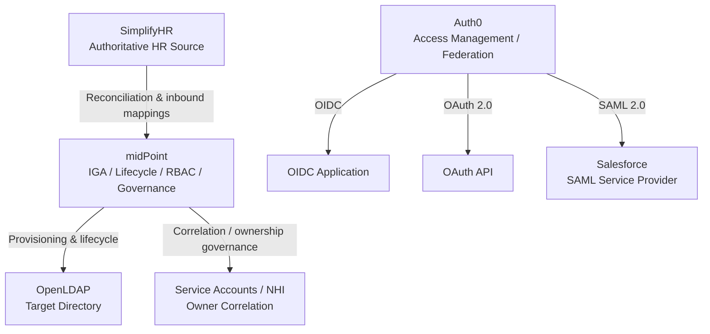
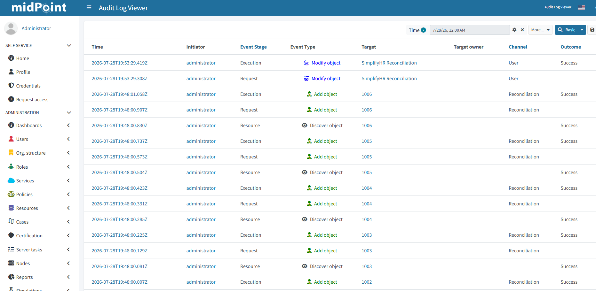
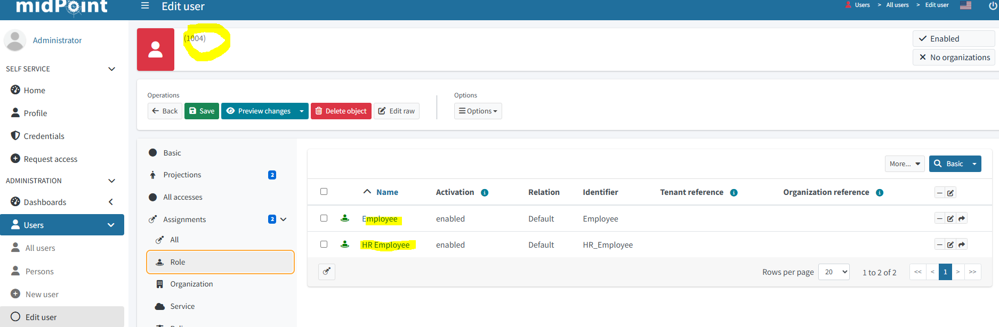
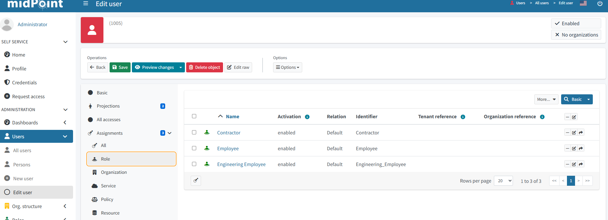
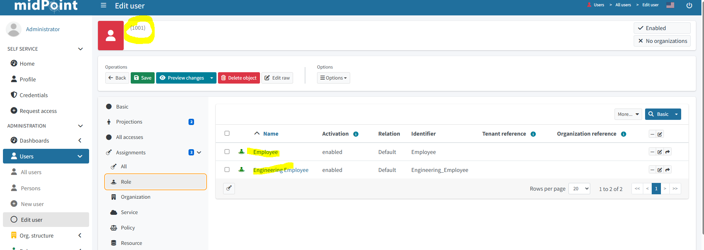
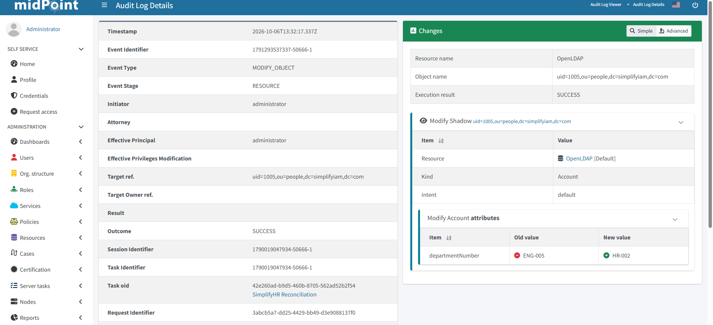
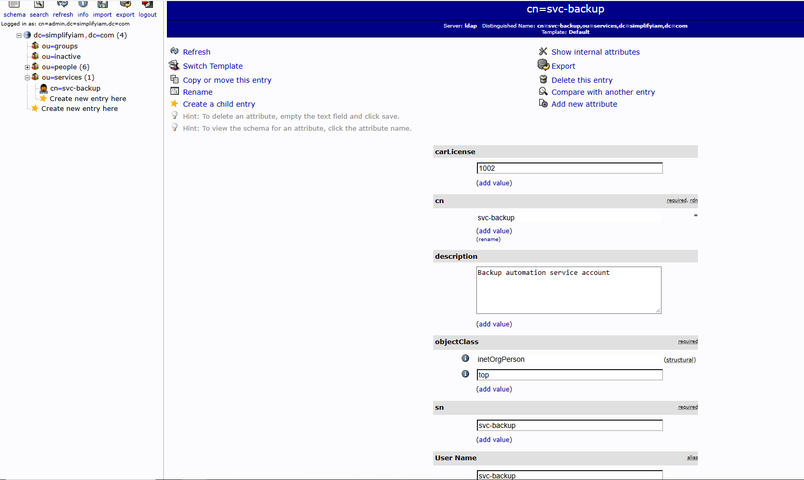
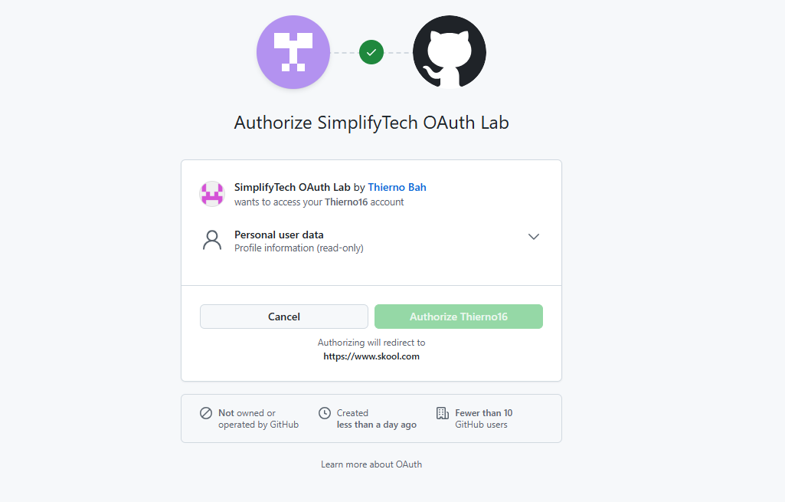
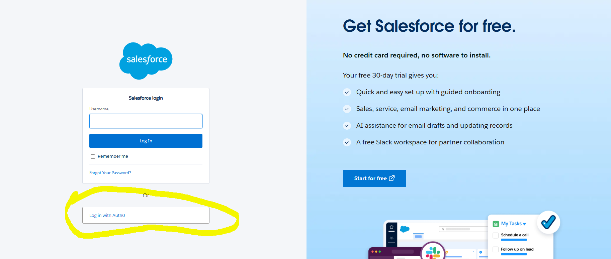

# 🔐 IAM / IGA / CIAM Implementation Portfolio

**Author:** Thierno Bah\
**GitHub:** https://github.com/Thierno16\
**Status:** Active portfolio --- hands-on IAM engineering lab

## Overview

This repository documents an end-to-end **Identity and Access Management
(IAM)** implementation covering **Identity Governance and Administration
(IGA), identity lifecycle automation, RBAC, access certification,
Non-Human Identity (NHI) governance, OAuth 2.0, OpenID Connect (OIDC),
and SAML federation**.

The environment simulates an enterprise IAM architecture in which
**SimplifyHR** acts as the authoritative identity source, **midPoint**
provides lifecycle and governance controls, **OpenLDAP** represents a
downstream enterprise directory, and **Auth0** provides
access-management and federation capabilities.

The purpose of this portfolio is not simply to show product screens. It
demonstrates the IAM problems I solved, the controls I implemented, the
evidence I collected, and the concepts I can explain and demonstrate in
an IAM engineering interview.

------------------------------------------------------------------------

## 🧭 Portfolio Navigation

-   [Architecture & Technology Stack](#-architecture)
-   [HR-Driven Identity
    Onboarding](#1-hr-driven-identity-onboarding--joiner)
-   [Provisioning to OpenLDAP](#2-provisioning-to-openldap)
-   [Role-Based Access Control](#3-role-based-access-control-rbac)
-   [Mover Lifecycle](#4-mover-lifecycle--engineering-to-hr)
-   [Access Certification & Governance
    Loop](#5-access-certification--the-governance-loop)
-   [Non-Human Identity
    Governance](#6-non-human-identity-nhi--service-account-governance)
-   [OAuth 2.0](#7-oauth-20--delegated-authorization)
-   [OpenID Connect](#8-openid-connect-oidc)
-   [SAML 2.0](#9-saml-20--enterprise-federation)

------------------------------------------------------------------------

## 🏗️ Architecture



### Technology Stack

  ---------------------------------------------------------------------
  Technology                         Role in the Lab
  ---------------------------------- ----------------------------------
  **midPoint**                       IGA, reconciliation, lifecycle,
                                     RBAC, certification, audit

  **SimplifyHR**                     Simulated authoritative HR source

  **OpenLDAP**                       Downstream directory /
                                     provisioning target

  **phpLDAPadmin**                   LDAP administration and
                                     verification

  **Auth0**                          Identity provider, OIDC/OAuth and
                                     SAML federation

  **Salesforce**                     SAML service provider

  **GitHub OAuth**                   Delegated authorization exercise
  ---------------------------------------------------------------------

------------------------------------------------------------------------

# Identity Governance & Administration (IGA)

## 1. HR-Driven Identity Onboarding --- Joiner

### Business problem

Manual identity creation is slow, inconsistent, and difficult to audit.
An enterprise IAM platform should consume authoritative workforce data
from HR and create identities consistently.

### What I built

I connected the simulated HR source to midPoint, configured inbound
identity mappings and reconciliation, and imported workforce identities
into midPoint.

``` text
SimplifyHR (HR source)
        ↓
Inbound mappings
        ↓
Correlation / reconciliation
        ↓
midPoint identity
```

### Key IAM concepts demonstrated

-   HR as the authoritative source
-   Identity correlation
-   Reconciliation
-   Attribute mapping
-   Automated identity creation
-   Auditability

### Evidence




### Interview takeaway

> I can explain how an authoritative HR source drives identity creation,
> how correlation prevents duplicate identities, and how reconciliation
> brings source changes into the IGA platform.

------------------------------------------------------------------------

## 2. Provisioning to OpenLDAP

### Business problem

Creating an identity in an IGA platform is not enough. The identity must
receive an account in the systems required to perform their job.

### What I built

I integrated midPoint with OpenLDAP and provisioned accounts from
governed identities into the target directory.

``` text
midPoint identity
      ↓
Role / resource construction
      ↓
Outbound mappings
      ↓
OpenLDAP account
```

### Key IAM concepts demonstrated

-   Target-system provisioning
-   Resource connectors
-   Outbound mappings
-   Account construction
-   Identity-to-account relationship
-   Verification in the target directory

### Evidence


### Interview takeaway

> I can explain the difference between an identity and an account and
> trace the provisioning path from a governed identity through a
> role/resource construction to the target directory.

------------------------------------------------------------------------

## 3. Role-Based Access Control (RBAC)

### Business problem

Granting access individually does not scale. RBAC groups permissions
around business responsibilities so access can be assigned consistently
and reviewed meaningfully.

### What I built

I implemented both **automatically assigned access** and **manually
requested access**. Department-based roles represent birthright access,
while additional access can remain explicitly assigned and therefore
requires governance oversight.

  -----------------------------------------------------------------------
  Access pattern          Example                 Governance behavior
  ----------------------- ----------------------- -----------------------
  Birthright /            Department role         Re-evaluated from
  auto-assigned                                   authoritative
                                                  attributes

  Manually                Contractor role         Persists until
  assigned/requested                              explicitly revoked or
                                                  certified
  -----------------------------------------------------------------------

### Evidence






### Key lesson

RBAC is not only about adding access. A well-designed model must also
define **when access should be removed** and avoid role explosion.

------------------------------------------------------------------------

## 4. Mover Lifecycle --- Engineering to HR

### Business problem

Movers are one of the highest-risk identity lifecycle events. A user can
accumulate access as they change departments, producing **access
creep**.

### What I built

I changed the user's authoritative department from **Engineering to HR**
and reconciled the identity. The department-driven role model
re-evaluated the user's access.

``` text
HR department change
        ↓
Reconciliation
        ↓
RBAC conditions re-evaluated
        ↓
Engineering access removed
        ↓
HR access granted
```

A manually granted role could remain after the move. That residual
access becomes the input to the certification process described next.

### Evidence





### Key lesson

> A successful mover process does not automatically prove that all
> access is still appropriate. Birthright access can follow HR
> attributes while manually granted access may require a human review.

------------------------------------------------------------------------

## 5. Access Certification & the Governance Loop

### Business problem

Provisioning controls answer **how access is granted**. Governance must
also answer **whether that access should still exist**.

The scenario focuses on **Emma Clarke**, who moved from Engineering to
HR. After the move she held:

  Role          Decision
  ------------- ------------
  Employee      ✅ Certify
  HR_Employee   ✅ Certify
  Contractor    ❌ Revoke

The stale Contractor role represents the kind of residual access that
certification is designed to detect.

### What I built

I configured and ran a midPoint access certification campaign:

**Campaign:** `Mover Access Review - Post Department Change`

The campaign reviewed Emma's role assignments and used a designated
reviewer, **Sophie Müller**, to make certification decisions. The
campaign was configured for automated remediation so non-conformant
access could be removed after review.

``` text
Department change
      ↓
Mover reconciliation
      ↓
Birthright roles re-evaluated
      ↓
Residual manually granted access
      ↓
Certification campaign
      ↓
Reviewer decision
      ↓
Contractor role revoked
      ↓
Automated remediation
      ↓
Auditable governance trail
```

### Evidence


### Key IAM concepts demonstrated

-   Access certification
-   Access review
-   Reviewer accountability
-   Access creep detection
-   Least privilege
-   Automated remediation
-   Audit evidence
-   Governance after a mover event

### Production design note

In this lab, Sophie was configured directly as the reviewer. In a
production implementation, reviewer resolution would commonly be derived
dynamically from the user's manager relationship or another governance
policy.

### Resume-ready bullet

> **Built and executed an access certification campaign in midPoint with
> reviewer-based access decisions and automated remediation, identifying
> and revoking stale access following a department change while
> preserving an auditable governance trail.**

------------------------------------------------------------------------

## 6. Non-Human Identity (NHI) & Service Account Governance

### Business problem

Service accounts are often powerful, long-lived, and difficult to
associate with an accountable person. An orphaned service account
without a valid owner is a governance risk.

### What I built

I modeled service accounts separately from normal workforce accounts and
used ownership data to correlate a service account to its responsible
human identity.

The implementation used the service-account owner reference from LDAP as
correlation data so midPoint could identify the accountable owner and
link the account appropriately.

``` text
OpenLDAP service account
        ↓
Owner reference
        ↓
midPoint NHI intent
        ↓
Correlation
        ↓
Human owner identified
        ↓
Service account linked to owner
```

Unmatched service accounts are intentionally treated differently from
new human identities: an unknown service-account owner should surface as
a governance finding rather than create a new workforce identity.

### Evidence




### Key IAM concepts demonstrated

-   Non-Human Identity governance
-   Service-account ownership
-   Correlation
-   Account intent / object classification
-   Orphaned-account risk
-   Human accountability for machine identities
-   Reconciliation and linking

### Resume-ready bullet

> **Implemented service-account governance in midPoint and OpenLDAP by
> classifying non-human accounts and correlating service accounts to
> accountable human owners, improving ownership visibility and reducing
> orphaned-account risk.**

------------------------------------------------------------------------

# Access Management & Federation

## 7. OAuth 2.0 --- Delegated Authorization

### Business problem

Applications often need limited access to a user's data without
receiving the user's password.

### What I built

I completed a delegated OAuth authorization flow and inspected the
consent experience and requested permissions.

### Evidence



### Key lesson

> OAuth 2.0 is primarily an **authorization** framework. It defines what
> an application is permitted to do on behalf of a user through scopes
> and access tokens.

------------------------------------------------------------------------

## 8. OpenID Connect (OIDC)

I extended the access-management portion of the lab with Auth0 and an
OIDC-enabled application, exploring authentication flows and token-based
identity.

### Key concepts

-   Identity Provider (IdP)
-   Relying Party / application
-   Authorization Code flow
-   ID token
-   Access token
-   JWT claims
-   Redirect URI
-   Authentication versus authorization

> **OIDC answers "Who is the user?" while OAuth focuses on "What is the
> application allowed to do?"**

Additional OIDC evidence and sanitized configuration can be added under
`screenshots/oidc/` and `artifacts/auth0/`.

------------------------------------------------------------------------

## 9. SAML 2.0 --- Enterprise Federation

### Business problem

Enterprise applications frequently rely on federation so users can
authenticate through a trusted Identity Provider instead of maintaining
a separate application password.

### What I built

I configured a SAML federation scenario using **Auth0 as the Identity
Provider** and **Salesforce as the Service Provider**.

The implementation covered the relationship between:

-   Identity Provider
-   Service Provider
-   ACS URL
-   Audience
-   NameID
-   Federation ID
-   SAML attributes
-   Signed assertions

### Evidence



### Interview takeaway

> I can explain how a SAML Service Provider trusts an assertion from an
> Identity Provider, how NameID identifies the user, and why the
> assertion signature and certificate are critical to establishing
> trust.

------------------------------------------------------------------------

# 🔄 End-to-End Governance Story

The strongest part of this lab is not any individual configuration. It
is the relationship between the controls:

``` text
Authoritative HR Source
        ↓
JOINER
Identity created
        ↓
PROVISIONING
Target account created
        ↓
RBAC
Birthright + requested access
        ↓
MOVER
Business attributes change
        ↓
Role model re-evaluates
        ↓
CERTIFICATION
Residual access reviewed
        ↓
REMEDIATION
Stale access revoked
        ↓
AUDIT
Evidence preserved
```

Alongside the workforce lifecycle, I also implemented
**NHI/service-account ownership governance**, while the Auth0 exercises
demonstrate the access-management and federation layer through **OAuth,
OIDC and SAML**.

------------------------------------------------------------------------

# 🧠 Skills Demonstrated

**Identity Governance & Administration** - Joiner / Mover / Leaver
concepts - HR-driven identity lifecycle - Identity correlation and
reconciliation - Provisioning - RBAC - Birthright vs requested access -
Access certification - Automated remediation - NHI / service-account
governance - Audit evidence

**Access Management** - OAuth 2.0 - OpenID Connect - JWT concepts - SAML
2.0 - Federation - Auth0

**Platforms** - midPoint - OpenLDAP - phpLDAPadmin - Auth0 - Salesforce

------------------------------------------------------------------------

# 📁 Repository Structure

``` text
IAM-IGA-CIAM-Implementation-Portfolio/
├── README.md
├── screenshots/
│   ├── foundations/
│   ├── joiner/
│   ├── provisioning/
│   ├── rbac/
│   ├── mover/
│   ├── certification/
│   ├── nhi/
│   ├── oauth/
│   └── saml/
└── artifacts/
    ├── midpoint/
    ├── openldap/
    └── auth0/
```

The `screenshots` directory contains visual implementation evidence. The
`artifacts` directory is reserved for sanitized configuration exports,
mappings, role definitions and scripts that can be safely published.

------------------------------------------------------------------------

# 🎯 Target Roles

This portfolio is designed to demonstrate practical skills relevant to
roles such as:

-   IAM Engineer
-   IGA Engineer
-   Identity & Access Management Analyst
-   Identity Governance Specialist
-   IAM Consultant
-   Junior / Associate IAM Architect
-   Identity Security Engineer

------------------------------------------------------------------------

# 💼 Portfolio Summary

Through this project I moved beyond IAM theory and implemented an
environment where I can trace an identity from an authoritative HR
source through lifecycle processing, provisioning, role assignment, a
department move, access review and remediation.

I can also demonstrate governance for non-human/service identities and
explain how OAuth 2.0, OIDC and SAML solve different access-management
and federation problems.

The repository is intended to provide **verifiable hands-on evidence**
of the IAM concepts I can discuss and demonstrate in an interview.

------------------------------------------------------------------------

## Next Improvements

-   Add sanitized midPoint XML resource exports and role definitions.
-   Add the inbound/outbound mapping scripts used in the implementation.
-   Add sanitized OIDC token-inspection evidence.
-   Add sanitized SAML assertion evidence.
-   Add dynamic manager-based reviewer resolution as an enhancement to
    the certification design.
-   Add a dedicated architecture diagram image for use on GitHub and
    LinkedIn.
